

  

<h1 align="center">NetTerminal</h1>

  <b>Terminal y herramientas de redes para Windows, macOS y Linux</b> 
  SSH · Telnet · Serial · Terminal local · Topología · Catálogo de comandos

  
  
  

---

## Qué es

NetTerminal es un cliente de conexión liviano para ingenieros de redes, técnicos de telecomunicaciones y soporte. Reúne SSH, Telnet, Serial y terminal local en una sola app, con sesiones en carpetas y pestañas, un catálogo de comandos verificados por fabricante y las herramientas de red que se usan en terreno y en la oficina.

Funciona en Windows 10/11, macOS (Intel y Apple Silicon) y Linux, pesa unos 8 MB y no consume CPU cuando no la estás usando.

| Sesiones y catálogo de comandos | Sugerencias mientras escribes |
| :---: | :---: |
| 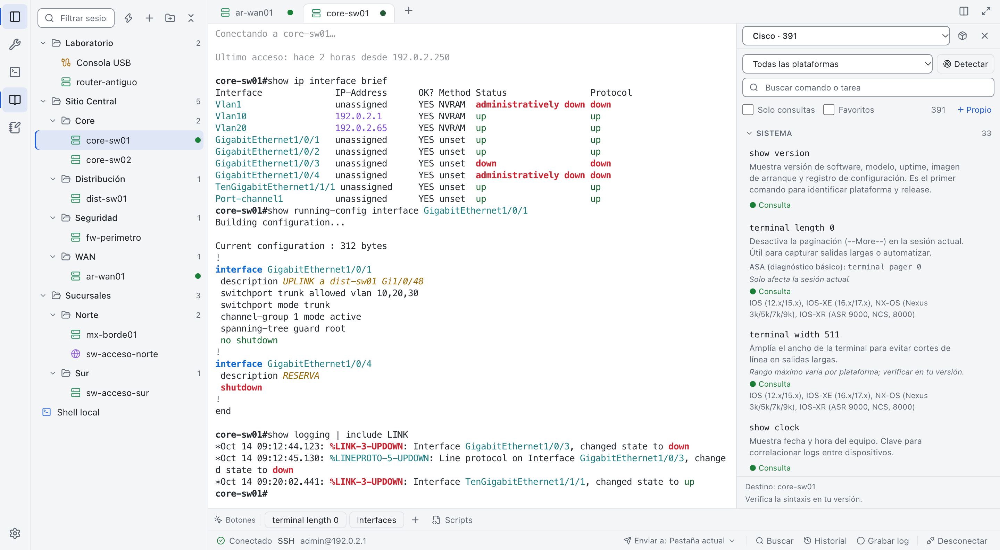 | 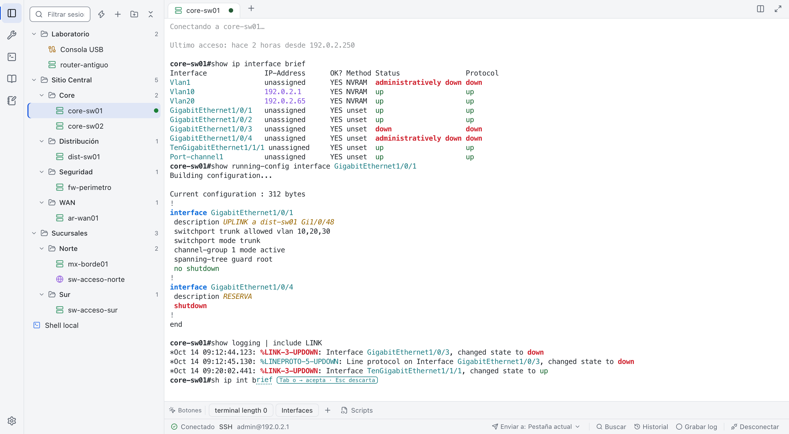 |

| Topología con ruta resaltada | Vista dividida para varios equipos |
| :---: | :---: |
| 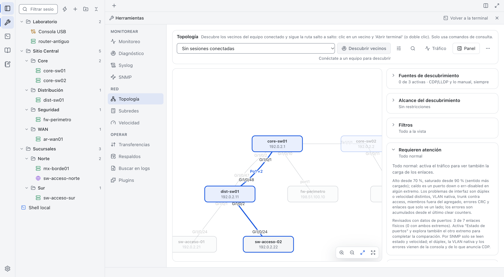 | 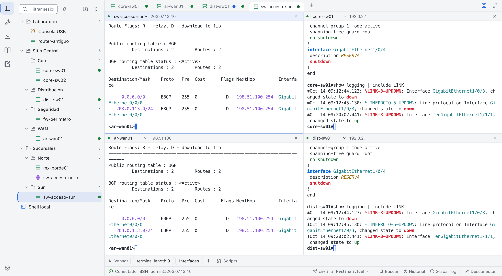 |

| Notas y plantillas con variables | Modo oscuro |
| :---: | :---: |
| 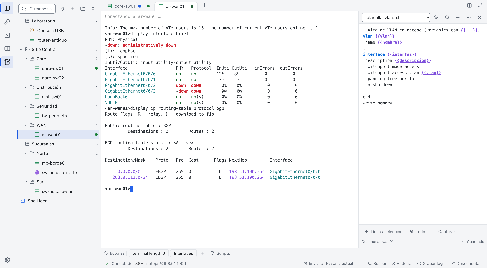 | 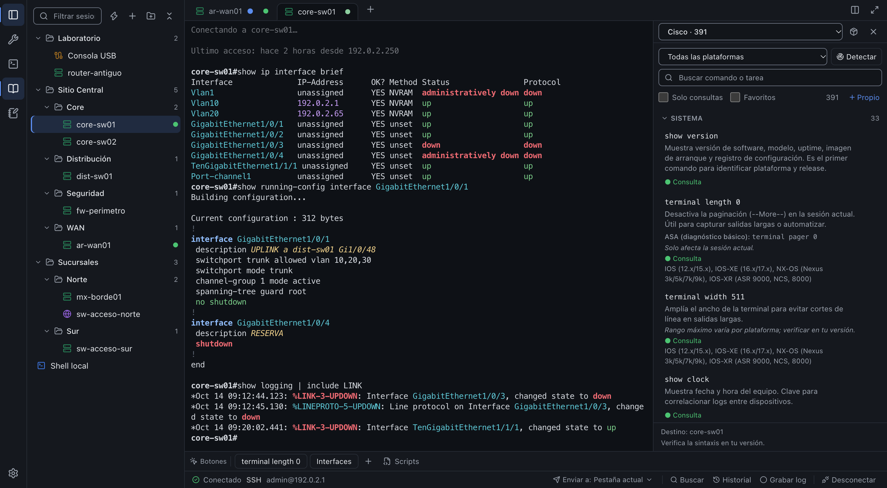 |

| Pegado seguro con riesgo por línea | Buscar en logs |
| :---: | :---: |
| 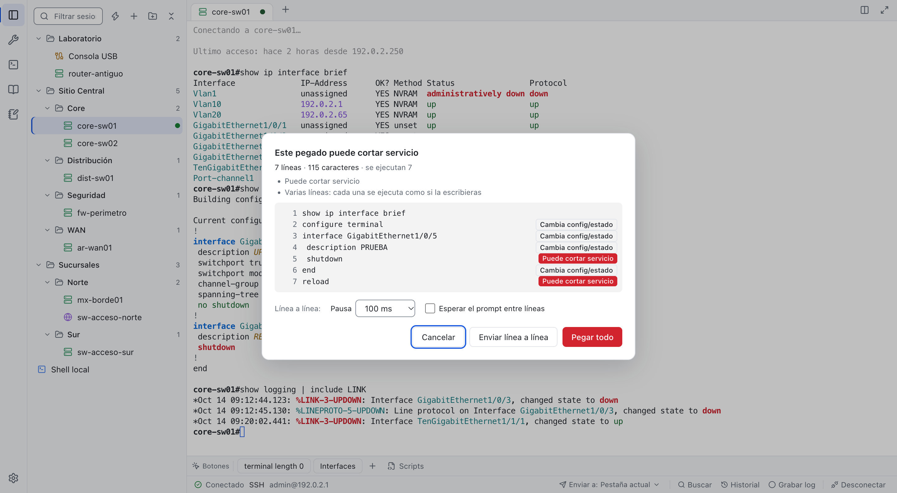 | 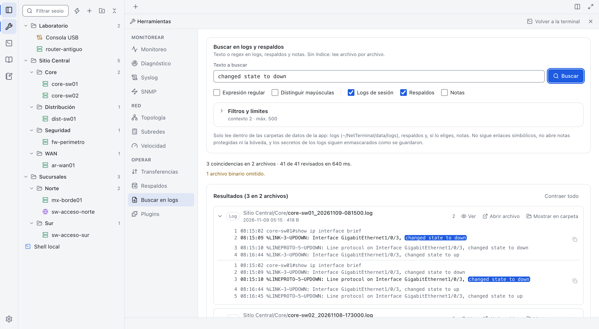 |

| Resaltado y marcadores | Archivo cifrado (.ntx) |
| :---: | :---: |
| 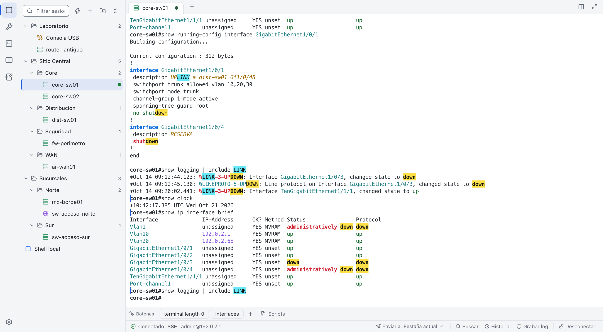 | 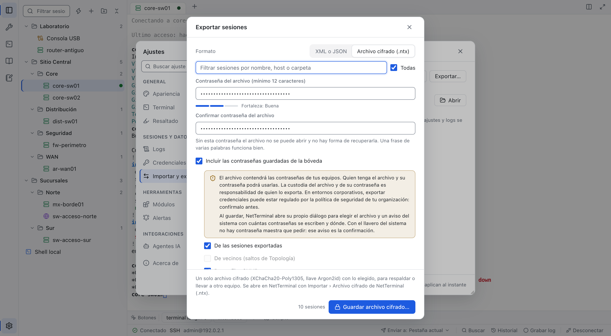 |

| Pestaña en solo lectura | Servidores con clientes permitidos |
| :---: | :---: |
| 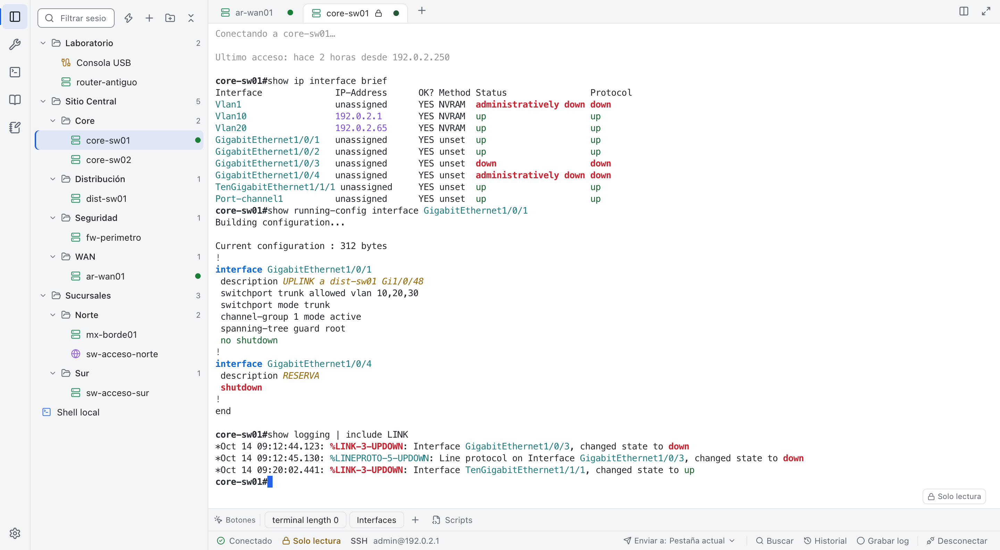 | 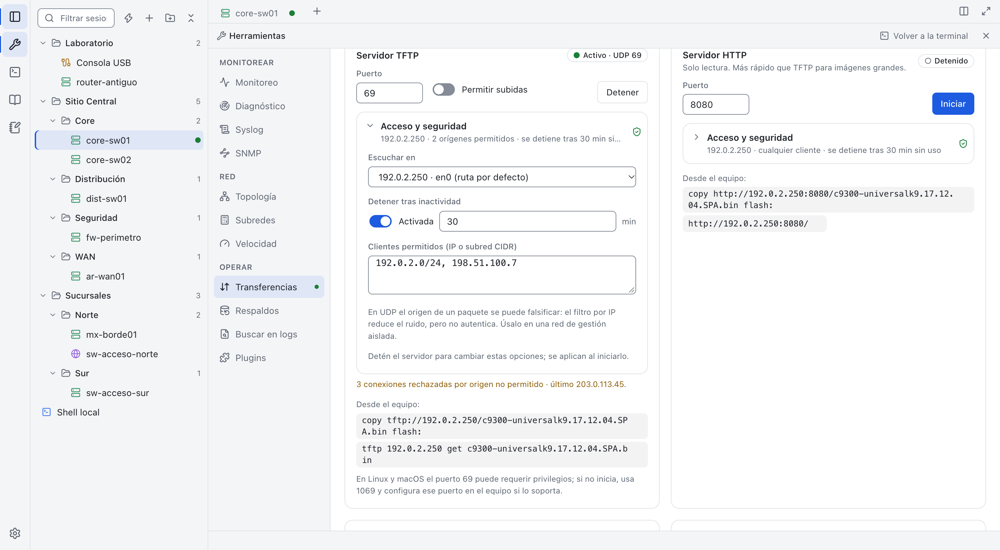 |

Las capturas usan datos ficticios.

---

## Herramientas

### Terminal
- **SSH, Telnet, Serial, TCP crudo y terminal local**, con jump host y soporte para equipos antiguos (algoritmos legacy opcionales).
- **Sesiones guardadas** en carpetas, **conexión rápida** e importación desde PuTTY, SecureCRT, MobaXterm, ssh_config o CSV.
- **Sugerencias de comandos** mientras escribes, también con abreviaturas, sin interferir con el autocompletado del equipo.
- **Pestañas horizontales o verticales**, vista dividida de hasta 4 equipos y modo foco.
- **Resaltado al vuelo y marcadores** en la salida de cada pestaña, para encontrar un texto o saltar entre comandos.
- **Pegado seguro**: vista previa con el riesgo de cada línea y envío línea a línea.
- **Solo lectura por pestaña** (modo monitoreo): la interfaz, el servidor MCP, los scripts y las transferencias dejan de escribir en esa conexión.

### Diagnóstico de red
- **Topología** de vecinos CDP / LLDP con estado de puertos, revisiones de enlaces (dúplex, VLAN nativa, Port-channel, CRC), tráfico por enlace y saltos encadenados entre vecinos.
- **Monitoreo** con alarma, ping, traceroute y puertos.
- **Calculadora de subredes** IPv4 e IPv6, **speedtest** e **iperf3**.

### Operación en terreno
- **Servidores TFTP, HTTP, FTP y SFTP** para respaldar configuraciones y subir firmware, con verificación MD5, interfaz de escucha, clientes permitidos y detención automática por inactividad.
- **Respaldos** y comparación de configuraciones.
- **Buscar en logs**: texto o regex en logs de sesión, respaldos y notas.
- **Syslog** y **SNMP v1, v2c y v3** de solo lectura, con receptor de traps.

### Productividad
- **Catálogo de comandos** de Cisco, Juniper, Fortinet, Huawei, Aruba, Check Point, WatchGuard, Grandstream, Linux, macOS y Windows, clasificados por riesgo (consulta, configuración, crítico) con confirmación antes de los críticos.
- **Notas y plantillas** con variables y envío a varias sesiones.
- **CLI Lab**: envía procedimientos línea a línea a una o varias sesiones y se detiene ante errores.
- **Scripts Python, plugins y agentes de IA (MCP)**, de solo lectura por defecto.
- **Bóveda cifrada** de credenciales, con bloqueo automático, y **ciclo de vida del equipo** (opcional).
- **Carpeta portable cifrada** (opcional): sesiones, ajustes, notas, historial, topología, respaldos y logs cifrados con tu contraseña maestra.
- **Archivo cifrado (.ntx)** para respaldar o llevar tus sesiones y ajustes a otro equipo; las contraseñas guardadas solo se incluyen si lo eliges.

---

## Alcance

| Herramienta | Windows | macOS | Linux |
| :--- | :---: | :---: | :---: |
| Terminal SSH / Telnet / Serial / local | ✅ | ✅ | ✅ |
| Topología, monitoreo y diagnóstico | ✅ | ✅ | ✅ |
| TFTP, HTTP, FTP, SFTP, Syslog y SNMP | ✅ | ✅ | ✅ |
| Catálogo, notas, CLI Lab y bóveda | ✅ | ✅ | ✅ |
| Buscar en logs y archivo cifrado (.ntx) | ✅ | ✅ | ✅ |
| Scripts Python, plugins y agentes de IA | Opcional | Opcional | Opcional |
| Actualización automática | ✅ | ✅ | AppImage |

**Opcional:** requiere Python instalado (scripts y plugins) o activarse en Ajustes (agentes de IA).

### Consideraciones
- **Serial en Linux**: tu usuario debe estar en el grupo `dialout` (o `uucp`).
- **macOS**: la app no tiene firma de Apple; la primera vez se abre con clic derecho › Abrir.
- **Funciones sensibles** (servidores TFTP, HTTP y FTP, traps SNMP, agentes de IA, algoritmos SSH legacy): apagadas hasta que tú las activas.

---

## Descarga

Instaladores en [Releases](https://github.com/Parzval-Net/Net_Terminal/releases/latest): `-setup.exe` para Windows (sin permisos de administrador), `.dmg` universal para macOS, `.AppImage` o `.deb` para Linux, y `NetTerminal-portable.zip` con los tres sistemas para usar desde un pendrive.

Otras ediciones: [Android](https://github.com/Parzval-Net/NetTerminal_Android) · [iOS](https://github.com/Parzval-Net/Net_Terminal_IOS)

---

## Licencia

[PolyForm Noncommercial 1.0.0](LICENSE.md). Se permite el uso no comercial (personal, educativo, investigación, organizaciones sin fines de lucro y entidades públicas). Cualquier uso comercial, incluido el uso interno en empresas, requiere una licencia aparte del autor. Las versiones publicadas antes del 31-10-2026 conservan los términos con que se distribuyeron. Las bibliotecas de terceros mantienen sus propias licencias ([THIRD_PARTY_NOTICES.md](THIRD_PARTY_NOTICES.md)).

© 2026 Nicolás Rivera ([@Parzval-Net](https://github.com/Parzval-Net))
